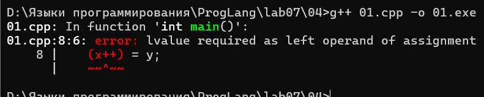

# Языки программирования
## Лабораторная работа 7

### Задание 1 **(2)**
*Оцените работу следующих фрагментов программ. Какие из них обладают неоднозначным поведением? Почему?*
```
int x=10, y=3;
std::cout << std::min(x=15, x+y);
```
Ответ:  
Обладает неоднозначным поведением, потому что компилятор может вычислить аргументы в любом порядке, и 
неизвестно какой аргумент будет использован, либо x=15 либо x=10

```
int x=10, y=3;
x=15, y+=x, x+=y;
```
Ответ:  
Не обладает неоднозначным поведением, поскольку запятая гарантирует очерёдность вычисления

```
int x=10, y=9;
if (x>y++ && y++>9)
  cout << "yes" << endl;
cout << y;
```
Ответ:  
Не обладает неоднозначным поведением, так как && гарантирует очерёдность вычисления

*Тексты программ разместите в папке с номером задания*

### Задание 2 **(2)**
*Как записать следующие строки программы на С++ в виде одного
выражения? Приведите несколько способов, в том числе с использованием операторов инкремента.*
*Проверьте работу написанных программ*
```
x=x+1;
z=z+2*x+3*y;
y=y+1;
```
*Тексты программ разместите в папке с номером задания*  
Ответ:  
```         
{int x =  1, y = 2, z = 0;
z=z+2*(x += 1)+3*(y++);
std::cout << z << " " << x << " " << y << std::endl;}
```
```
{int x = 1, y = 2, z = 0;
z = z + 2 * (++x) + 3 * (y++);
std::cout << z << " " << x << " " << y<< std::endl;}
```

### Задание 3 **(2)**
*Рассмотрите следующий фрагмент программы. Он заполняет вектор из 10 элементов единицами.*
```
std::vector<int> x(10);
for (int i = 0; i < 10;)
   x[i++] = 1;
```
*Перепишите ее так, чтобы в третьей строке использовался префиксный инкремент, но результат ее работы не изменился.*
```
std::vector<int> x(10);
for (...)
   x[++i]=1;
```

### Задание 4 **(2)**

*Почему присваивание* ```(++x)=y``` *является синтаксически правильным, а*
```(x++)=y``` - *нет? Запишите текст сообщения об ошибке, переведите и объясните его.*  
Ответ:  
   
Перевод: ошибка, в качестве левого операнда присваивания требуется lvalue (модифицируемое значени)  
```(x++)=y``` не является правильным, потому что это временное значение и в ней нельзя хранить другие значения, 
т.к. оно не имеет местоположение в памяти


### Задание 5 **(2)**

*Программисты на Python для обмена значений двух переменных часто пишут строку*
```
a,b = b,a
```
*Проверьте, будет ли аналогичная строка на С++ (с точкой с запятой в конце) являться синтаксически
правильной? Будет ли она обменивать значения переменных? Как в языке С++ вычисляется это выражение?*  
Ответ:  
Да, эта строка будет синтаксически правильная, но значения обменивать не будет. Сначала просто 
вызывается переменная a, затем b присваивается b и вновь вызывается переменная a  

### Задание 6 **(2)**

*Проверьте работу следующего фрагмента программы*
```
  std::string s;
  for (int i=0; i<1000000; i++)
     s += 'a';
  std::cout << s.size();
```
*Измените третью строку на*
```
s=s+'a';
```
*Изменится ли что-нибудь в ее работе? Объясните результат.*
Ответ:  
В работе результат программы не изменился, изменилось только время работы программы. Потому что в первом 
случае символ дописывался в выделенную память, 
а во втором случае каждый раз создавался временный объект

### Задание 7 **(2)**

*Как работает следующая программа? Как зависит результат от исходного значения?*
```
int x;
std::cin >> x;
x-->0 && x-->0 && x-->0 && x-->0 && x-->0;
std::cout << x;
```
Ответ:  
Разбить программу на токены (понять что написано)  
Посмотреть приоритеты операций  
Сначала -- потом > потом &&  
Разобраться с последовательностью применений операций  
По стандарту для С++ у конъюкцции строго слева направо  
Разобраться с побочными децствиями  
Это пять применений --  
Посмотреть порядок побочных действий  
По стандрату С++ при вычислении && побочные действия связанные с вычислением левого операнда упорядоченны до выччисления правого. И наоборот тоже  
По стандарту С++ если левый операнд && равен false то вычисления правого не выполняется.  
Суффиксный -- побочное действие упорядоченно после вычисления результата.  

Если x<=0 то выведет x-1  
Если 0<x<=4 то -1    
Если x>4 то x-5

### Задание 8 **(3)**

*Какое число выводит следующий фрагмент программы? Посчитайте результат без использования
вычислительной техники. Отчет должен содержать процесс вычислений.*
```
int s = 0;
for (int i = 0, j = 5;i+j <= 16;(i<j ? i : j)++)
   (s += i) += j;
std::cout << s;
```
Ответ:  
1 проход:    
i = 0, j = 5, сумма i и j = 5 < 16, i < j , значит к i должны прибавить 1      
Затем к s прибавляем i и получаем, 0 + 0 и s=0, и потом к нему прибавляем j и получаем 5 + 0 = 5  
теперь i стало равно 1

2 проход:  
i = 1, j = 5, сумма i и j = 6 < 16, i < j , значит к i должны прибавить 1  
Затем к s прибавляем i и получаем, 5 + 1 и s = 6, и потом к нему прибавляем j и получаем 5 + 6 = 11  
теперь i стало равно 2  

3 проход:  
i = 2, j = 5, сумма i и j = 7 < 16, i < j , значит к i должны прибавить 1  
Затем к s прибавляем i и получаем, 11 + 2 = 13, и потом к нему прибавляем j и получаем 5 + 13 = 18  
теперь i стало равно 3  

4 проход:  
i = 3, j = 5, сумма i и j = 8 < 16, i < j, значит к i должны прибавить 1  
Затем к s прибавляем i и получаем, 18 + 3 = 21, и потом к нему прибавляем j и получаем 5 + 21 = 26  
теперь i стало равно 4  

5 проход:  
i = 4, j = 5, сумма i и j = 9 < 16, i < j, значит к i должны прибавить 1  
Затем к s прибавляем i и получаем, 26 + 4 = 30, и потом к нему прибавляем j и получаем 5 + 30 = 35  
теперь i стало равно 5  

6 проход:  
i = 5, j = 5, сумма i и j = 10 < 16, i == j, значит к j должны прибавть 1  
Затем к s прибавляем i и получаем, 35 + 5 = 40, и потом к нему прибавляем j и получаем 5 + 35 = 45  
теперь j стало равно 6  

7 проход:  
i = 5, j = 6, сумма i и j = 11 < 16, i < j, значит к i должны прибавить 1  
Затем к s прибавляем i и получаем, 45 + 5 = 50, и потом к нему прибавляем j и получаем 6 + 50 = 56  
теперь i стало равно 6  

8 проход:  
i = 6, j = 6, сумма i и j = 12 < 16, i == j, значит к j должны прибавить 1  
Затем к s прибавляем i и получаем, 56 + 6 = 62, и потом к нему прибавляем j и получаем 6 + 62 = 68  
тепеерь j стало равно 7  

9 проход:  
i = 6, j = 7, сумма i и j = 13 < 16, i < j, значит к i должны прибавить 1  
Затем к s прибавляем i и получаем, 68 + 6 = 74, и потом к нему прибавляем j и получаем 7 + 74 = 81  
теперь i равно 7  

10 проход:  
i = 7, j = 7, сумма i и j = 14 < 16, значит к j должны прибавить 1  
затем к s прибавляем i и получаем, 81 + 7 = 88, и потом к нему прибавляем j и получаем 7 + 88 = 95  
теперь j равно 8  

11 проход:  
i = 7, j = 8, сумма i и j = 15 < 16, значит к i должны прибавить 1  
Затем к s прибавляем i и получаем, 95 + 7 = 102, и потом к нему прибавляем j и получаем 8 + 102 = 110  
теперь i равно 8  

12 проход:  
i = 8, j = 8, сумма i и j = 16 = 16, значит к j должны прибавить 1  
Затем к s прибавляем i и получаем, 110 + 8 = 118, и потом к нему прибавляем j и получаем 8 + 118 = 126  
теперь j равно 9  

13 приход:  
i = 8, j = 9, сумма i и j = 17 > 16, условие не выполнено, значит программа выходит из цикла и выводит 126

###  Задание 9 **(3)**
*Рассмотрите следующую программу. Предполагается, что на вход подается некоторый
индекс в массиве - число от нуля до девяти и значение, которое надо записать по этому индексу.*
```
int i = 0;
std::vector<int> x(10);
std::cin >> i >> x[i];
std::cout << x[i];
```
*Проверьте работу этой программы на различных компиляторах. Найдите два компилятора (можно 
проверить онлайн компиляторы), на которых эта программа будет давать различные ответы при одинаковом
вводе. Как это объяснить?*

## Дополнительные задания

### Задание 1 **(2)**

*Найдите и объясните примеры "коварных" ошибок программистов на С++, связанных с вычислением выражений. 
Каждый пример оценивается в два балла. Примеры из лекции или из заданий не засчитываются.*

### Задание 2 **(10)**
*Язык С++ позволяет записывать достаточно странные конструкции.
Следующая программа обладает неопределенным поведением. После компиляции с использованием 
Gnu C++ (g++) эта программа выводит числа 4 и 11. Рассмотрите ассемблерный код и объясните,
каким образом был получен ответ 11.*
```
int x, y;
y = (x=1) + (x=2) + (x=3) + (x=4);
std::cout << x << " " << y;
```

### Задание 3 **(10)**
*Прочитайте в стандарте языка С++ правила вычисления результата для тернарного оператора* **?:**. *Напишите примеры для каждого пункта правил.*